<p align="center">
  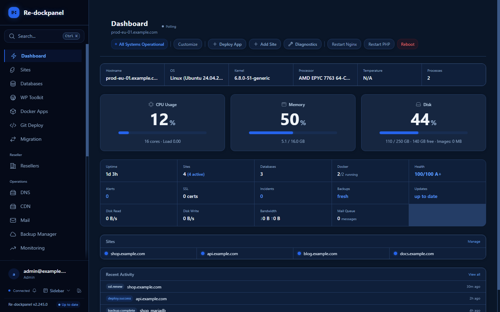
  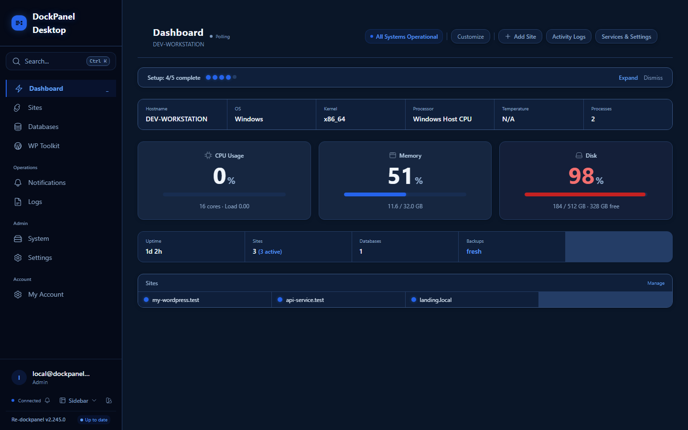
</p>

<h1 align="center">Re-dockpanel</h1>

<p align="center">
  <strong>Cloud Server Control Panel &amp; Native Desktop Local Development Suite</strong><br>
  Enhanced, Feature-Packed Fork of DockPanel by <a href="https://github.com/Juni4567">Junaid (@Juni4567)</a> &bull; Originally by <a href="https://github.com/ovexro/dockpanel">@ovexro/dockpanel</a>.<br>
  Self-hosted. Written in Rust + React. <strong>~49MB RAM</strong> on Linux servers. Native <strong>Windows Desktop</strong> app. Zero subscriptions.
</p>

<p align="center">
  <sub>Two editions, one unified workflow: <strong>Re-dockpanel Cloud</strong> for production Linux VPS/dedicated servers, and <strong>DockPanel Desktop</strong> for local Windows development with bidirectional live sync.</sub>
</p>

<p align="center">
  <a href="https://github.com/Juni4567/Re-dockpanel/releases"></a>
  <a href="https://github.com/Juni4567/Re-dockpanel/actions"></a>
  <a href="LICENSE"></a>
  <a href="https://github.com/ovexro/dockpanel"></a>
</p>

<p align="center">
  <a href="#-two-editions-cloud--desktop">Cloud &amp; Desktop</a> &bull;
  <a href="#install">Install</a> &bull;
  <a href="#screenshots">Screenshots</a> &bull;
  <a href="CHANGELOG.md">Changelog</a> &bull;
  <a href="https://github.com/Juni4567/Re-dockpanel/releases">Releases</a>
</p>

---

## 🌐 Two Editions: Cloud & Desktop

| | ☁️ Re-dockpanel Cloud (Linux) | 🖥️ DockPanel Desktop (Windows) |
|---|---|---|
| **Target** | Production VPS, dedicated & homelab Linux servers | Local Windows workstation development |
| **Architecture** | Rust/Axum (`api` + `agent` + `cli` + `mcp`) + PostgreSQL 16 + Nginx + Docker | Pure-Rust native app (`Tao` + `Wry` + `Axum`) + Windows Host Helper service |
| **Runtimes** | Static, PHP (8.1–8.5), Node.js, Python, Reverse Proxy | Static, PHP (7.4–8.6), Node.js (`PATH` / `nvm-windows` / `fnm` / `Volta`) |
| **Databases** | Dockerized MariaDB 11 & PostgreSQL 16 + SQL Studio | Portable MariaDB 11 + Zero-config SQLite + SQL Studio |
| **SSL / Domains** | Automatic Let's Encrypt (Certbot) + SNI isolation | Zero-UAC `.test` / `.local` hosts + `mkcert` local Root CA HTTPS |
| **WordPress** | 4-Tab Plesk-style WordPress Toolkit + auto-MariaDB | 1-click cached WordPress install (SQLite or MariaDB) + full Toolkit |
| **Deployment** | Git Push-to-Deploy (zero-downtime), 147 Docker App templates, Multi-server | 1-click **Push / Pull Live Sync** with remote Cloud servers |
| **Install** | One-line `curl \| sudo bash` | Standalone `DockPanel-Desktop-Setup.exe` ([Releases](https://github.com/Juni4567/Re-dockpanel/releases)) |

---

## 🚀 What's Different from Upstream (`ovexro/dockpanel`)

This fork (`Re-dockpanel`) includes key production improvements, bug fixes, and workflow enhancements:

### 1. 🗂️ Major File Manager Upgrade
- **Interactive Directory Tree Sidebar**: Collapsible left sidebar with real-time, lazy-loading subdirectories (`▶` / `▼`). Easily navigate deep WordPress or application trees (`public/`, `wp-content/`, `plugins/`, etc.) without losing your position.
- **Archive Compression & Extraction**:
  - Direct 1-click in-panel extraction for `.zip`, `.tar.gz`, `.tgz`, `.tar`, and `.tar.bz2` files.
  - Multi-select archive compression to `.zip` or `.tar.gz` with custom naming.
  - Automatic recursive ownership setting to `www-data:www-data` upon extraction (preserving `.git` security).
- **File Permissions & Ownership Details**:
  - Displays Unix octal permissions (e.g., `0755`, `0644`, `0640`) and ownership (`www-data:www-data`).
  - Interactive **Chmod Modal** with presets (`0755 Dir`, `0644 File`, `0640 Protected Config`, `0777 Full`) and recursive `-R` toggle.
  - Interactive **Chown Modal** with presets (`www-data:www-data`, `root:root`) and recursive `-R` toggle.
- **Batch Operations**: Multi-select checkboxes with a "Select All" header, plus a floating action bar for batch Copy, Move, Compress, and Delete.
- **Enhanced Code & Text Editor**: In-browser code editor with fullscreen toggle, keyboard shortcut `Ctrl+S` / `Cmd+S` for quick saving, tab-key indentation, and live save status indicators.
- **Permission & Ownership Hygiene**: All newly uploaded, created, or extracted files automatically receive `www-data:www-data` ownership so PHP-FPM and Nginx never encounter `Permission Denied` errors.

### 2. ⚡ 1 GB+ Large File Uploads & Progress Bar
- **Expanded Limits**: Raised the former ~1.5 MB body limit on both panel-to-backend and backend-to-agent hops to **1 GB minimum** (`1_073_741_824` bytes), supported by 2 GB body limit layers.
- **Real-Time Progress UI**: Live upload progress bar showing transfer percentage, transferred vs total MB, and distinct processing states (`reading` -> `uploading` -> `processing`).

### 3. 🔒 Multi-Domain SSL / SNI Isolation Fix
- Resolves `net::ERR_CERT_COMMON_NAME_INVALID` where Nginx fallback certificate collisions caused certificates from one domain (e.g. `site-a.example.com`) to be served on unrelated domains (e.g. `site-b.example.com`, `panel.example.com`).
- Enforces strict SNI virtual host matching and independent SSL certificate resolution.

### 4. 🛠️ Git Deploy Incident Blocker Resolution & Private Repositories
- **Incident Deadlock Fix**: Solved the issue where active incidents (`Deploy blocked: active critical/major incident in progress`) halted git deploys indefinitely.
- **Actionable Incident Banner**: Displays full incident details (title, severity badge, description, start timestamp) with 1-click **"Force Deploy Anyway"**, **"Resolve & Deploy"**, and **"Delete Incident"** controls.
- **Private Repository Support**: Automatically injects GitHub access tokens (`x-access-token`) into HTTPS clone URLs for private repo deployments.

### 5. 🌐 Rate Limit Tuning
- Site creation rate limit increased to **10 sites/hour** (up from 3) for smoother setup of multi-domain hosting environments.

### 6. 🔄 Automated Build & Deploy Pipeline
- Automated `./deploy.sh all` script that pulls from `Juni4567/Re-dockpanel`, builds Vite frontend assets, compiles Rust release binaries (`dockpanel-api` and `dockpanel-agent`), and performs rolling service restarts.

### 7. 🧰 Plesk-Style WordPress Toolkit (4-Tab Overhaul)
- **4 Dedicated Management Tabs**:
  - **Dashboard**: Live website screenshot preview with zoom modal, 1-click `/wp-admin` login, credential setup, core/plugin/theme update alerts, PHP details, debugging toggle, password protection, Let's Encrypt status, security mitigations, nginx caching, and WordPress integrity checker.
  - **Plugins Tab**: Full plugin inventory with activation toggles, autoupdate toggles, vulnerability warnings, one-click updates, and delete actions.
  - **Themes Tab**: Theme library with active theme badge, activation toggles, and autoupdate controls.
  - **Database Tab**: Direct 1-click link to Database Manager, table prefix inspection, database user, and server connection info.
- **Top-Level Scan**: Discover WordPress installations across the entire server with a single click.

### 8. 🗄️ Built-in SQL Management Studio & Browser
- **Robust SQL Import Pipeline**: Streaming sed filter regexes automatically handle phpMyAdmin and standard mysqldump exports (stripping privileged `CREATE DATABASE`/`USE` and injecting `DROP TABLE IF EXISTS`), restoring multi-gigabyte databases reliably.
- **Inline Cell Editing**: Double-click any table cell in the Browse view to edit values inline with keyboard shortcuts (`Enter` to save, `Esc` to cancel).
- **Disk Usage & Direct Navigation**: Database list displays container disk sizing (`MB`/`GB`) and database names link directly to the data browser.
- **Engine Consistency**: Accurate labeling of `MariaDB 11` (MySQL-compatible) and `PostgreSQL 16` across all views.

### 9. 🌐 Enhanced Sites Listing & Quick Actions
- **Live Metrics**: Real-time disk usage and monthly traffic estimation per site.
- **Server Path Location**: Direct filesystem address display (`/var/www/{domain}/public`).
- **Quick Action Icons**: Dedicated 1-click navigation icons to **File Manager**, **Mail**, and **Database**.
- **Domain Utilities**: Copy domain button with animated feedback, external link to open in new tab, and dynamic favicon resolution via Google Favicon service.

### 10. 🔒 Custom Panel Domain & Automatic Let's Encrypt SSL
- Reconfigure the panel to run securely on a custom domain (e.g. `panel.yourdomain.com`).
- Integrated Certbot automation issues and renews Let's Encrypt SSL certificates.
- Seamless dual-port SNI routing: port 80 automatic HTTP→HTTPS redirect, standard port 443 HTTPS access, and port 8443 direct IP fallback.

### 11. 🖥️ DockPanel Desktop (Native Windows Local Development Environment)
- **Pure-Rust Native App (`Tao + Wry + Axum`)**: Lightweight Windows desktop workstation app with an embedded Axum HTTP/HTTPS router, zero Docker/WSL overhead required.
- **PHP (7.4–8.6), Node.js & Static Runtimes**: Download/switch PHP versions on demand, run native Node.js apps (auto-detecting `PATH`, `nvm-windows`, `fnm`, `Volta`, Scoop, and Chocolatey with `$PORT` management), or serve static sites.
- **Zero-UAC Local Domains**: Seamless `.test` and `.local` domain resolution via the background Windows Named Pipe Host Helper (`dockpanel-host-helper`) without Windows UAC popups.
- **Locally-Trusted Green-Padlock HTTPS**: Bundled `mkcert` local Root CA + `tokio-rustls` SNI TLS termination on port `443` / `8443` for every local site.
- **Portable MariaDB 11 & Zero-Config SQLite**: Run a bundled portable MariaDB server alongside SQLite databases, complete with the built-in SQL Studio, inline row editing, and `.sql` dump import/export.
- **Cached 1-Click WordPress Toolkit**: Fast offline-cached WordPress core + SQLite/MariaDB provisioning with streaming progress, plugin/theme/debug/security controls, and checksum integrity verification.
- **Custom Site Paths & Bidirectional Live Sync**: Choose custom local folder paths per site, open directly in Explorer or VS Code, and push/pull sites to remote Re-dockpanel Cloud servers.
- **Standalone Inno Setup Installer**: Ships as `DockPanel-Desktop-Setup.exe` in [GitHub Releases](https://github.com/Juni4567/Re-dockpanel/releases). See [**docs/desktop/README.md**](docs/desktop/README.md) for details.

---

## Upstream Attribution

`Re-dockpanel` is a fork of [**DockPanel**](https://github.com/ovexro/dockpanel), originally created and maintained by [@ovexro](https://github.com/ovexro). We deeply appreciate the incredible architecture and foundation provided by the upstream project.

---

## Install

### ☁️ Cloud Server (Linux)

```bash
curl -sL https://raw.githubusercontent.com/Juni4567/Re-dockpanel/main/scripts/install.sh | sudo bash
```

Open `https://YOUR_SERVER_IP:8443`, create your admin account, done. Without a domain the
panel serves a self-signed certificate, so your browser warns once — it is there so the
admin password you create is encrypted on the way to the server. Point a domain at the box
and pass `PANEL_DOMAIN=your.domain` to get a trusted Let's Encrypt certificate instead.

Supports Ubuntu 20+, Debian 11+, CentOS 9+, Rocky 9+, AlmaLinux 9+, Fedora 39+. x86_64 and ARM64.
On the RHEL family the optional-service installers (Redis, Node.js, PowerDNS, WAF, Cloudflare
Tunnel) work from the panel as of v2.40.0; the mail server still refuses there, and UFW refuses
on any firewalld box by design. See [getting started](docs/getting-started.md#requirements).

### 🖥️ Desktop (Windows)

Download **`DockPanel-Desktop-Setup.exe`** from the latest `desktop-v*` release on [GitHub Releases](https://github.com/Juni4567/Re-dockpanel/releases) and run the installer. It sets up the native desktop app, `DockPanelHostHelper` service for zero-UAC `.test`/`.local` domains, and `mkcert` local HTTPS automatically.

## Why DockPanel?

No other free panel gives you Git push-to-deploy with blue-green zero-downtime updates, 147 one-click Docker app templates, per-image CVE scanning with deploy gating, a WAF, passkey login, GPU passthrough, multi-server management, reseller accounts, a developer CLI, and Infrastructure as Code — all while the panel services themselves use under 20MB of RAM. DockPanel does.

| | DockPanel | HestiaCP | CloudPanel | RunCloud |
|---|---|---|---|---|
| **Price** | **Free** | Free | Free | $8/mo+ |
| **Stack** | **Rust + React** | PHP | PHP | PHP (SaaS) |
| **Docker native** | **147 templates** | No | No | No |
| **Git deploy** | **Blue-green, zero-downtime** | No | No | Basic |
| **Multi-server** | **Unlimited** | No | No | Yes |
| **Reseller + white-label** | **Yes** | Reseller only | No | No |
| **CLI + IaC** | **Full CLI + YAML export** | Limited | No | No |
| **RAM usage (panel)** | **~49MB** | ~200MB+ | ~150MB+ | SaaS |
| **ARM64 / Homelab** | **Yes** | Partial | No | No |
| **Self-hosted** | **Yes** | Yes | Yes | No |

A feature table is easy to write, so here is the harder claim: before each
release DockPanel is installed on a throwaway VPS with a real domain and a real
Let's Encrypt certificate, and each journey is driven to the point where a user
would get value from it — mail is not "installed", a message is sent to another
server and its DKIM signature checked on arrival. That has repeatedly found
features whose setup half worked and whose payoff half had never once run.
[How DockPanel is tested](https://docs.dockpanel.dev/testing.html) lists what it
found, including what is still broken.

## Screenshots

### 🖥️ DockPanel Desktop (Windows)

<details open>
<summary><strong>Desktop Dashboard</strong> — Native Windows workstation metrics, active sites, and quick actions</summary>


</details>

<details>
<summary><strong>Desktop Sites</strong> — Local PHP, Node.js, and Static sites with HTTPS &amp; quick Explorer/VS Code actions</summary>

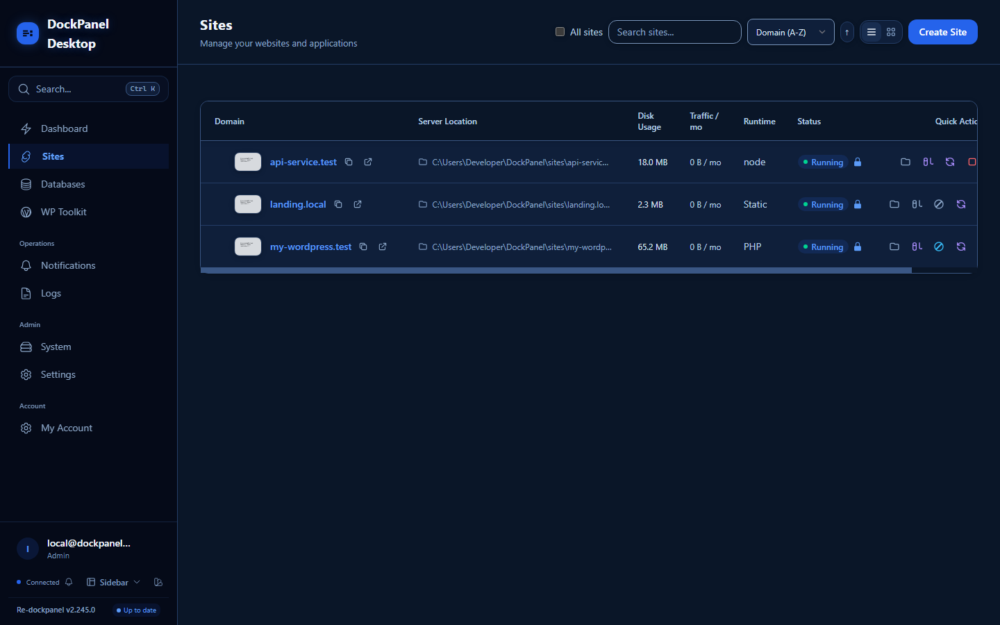
</details>

<details>
<summary><strong>Create Local Site</strong> — Quick Install presets (WordPress, Laravel, etc.), <code>.test</code>/<code>.local</code> domains, Node.js &amp; PHP runtimes</summary>

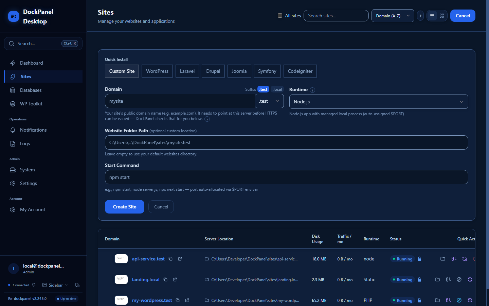
</details>

<details>
<summary><strong>Desktop WordPress Toolkit</strong> — Local multi-site WordPress management, updates, and vulnerability overview</summary>

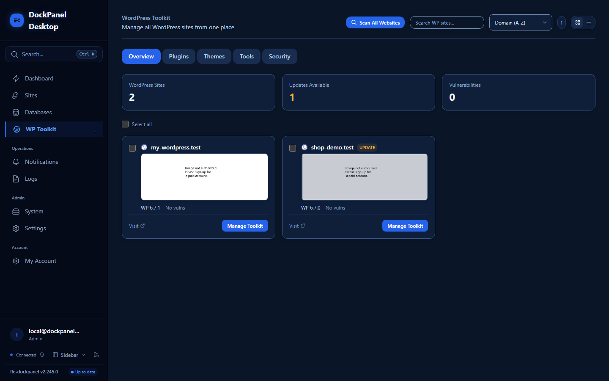
</details>

<details>
<summary><strong>Desktop Databases</strong> — Portable MariaDB 11 &amp; local SQLite databases with built-in SQL Studio</summary>

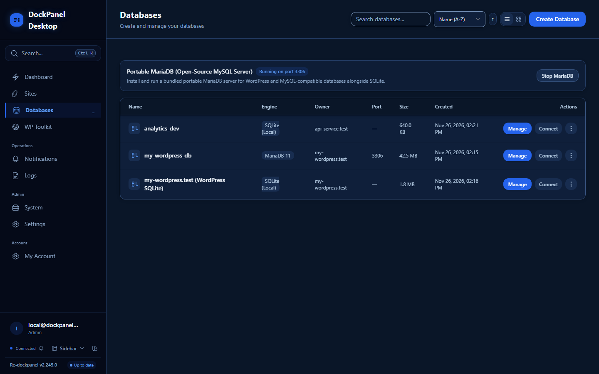
</details>

<details>
<summary><strong>Desktop Settings</strong> — Configurable default websites directory, branding, and PHP &amp; Services manager</summary>

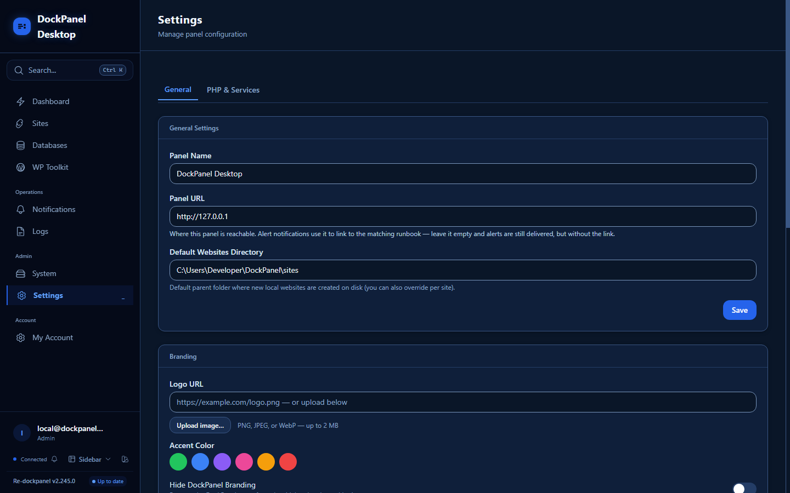
</details>

### ☁️ Re-dockpanel Cloud (Linux Server)

<details>
<summary><strong>Dashboard</strong> — Live server metrics, 24h graphs, site overview, recent activity</summary>


</details>

<details>
<summary><strong>Sites</strong> — Static, PHP, Node.js, Python, reverse proxy with Nginx + SSL</summary>

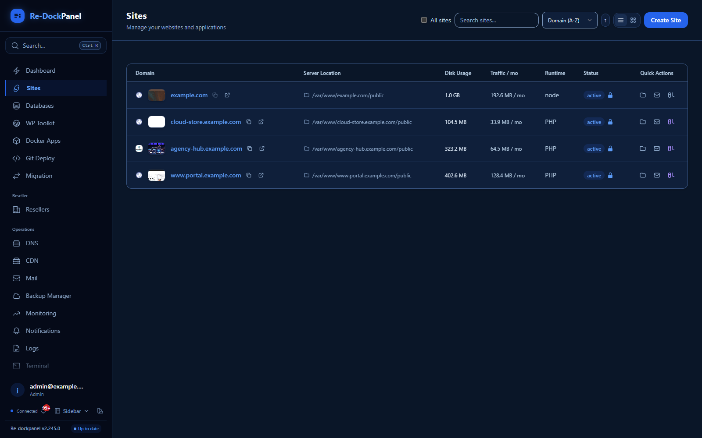
</details>

<details>
<summary><strong>Site Detail</strong> — SSL, WAF, file manager, terminal, backups, resource limits, custom nginx</summary>


</details>

<details>
<summary><strong>Docker Apps</strong> — 147 one-click templates across 14 categories</summary>


</details>

<details>
<summary><strong>WordPress Toolkit</strong> — Plesk-style dashboard, live preview, plugins, themes, database tools, security and performance toggles</summary>

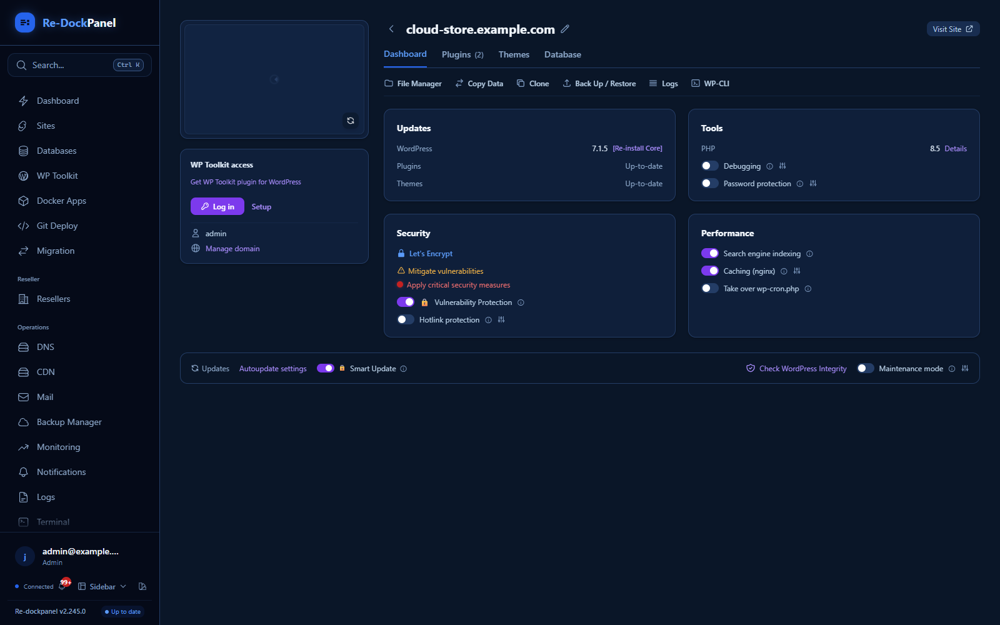
</details>

<details>
<summary><strong>Databases</strong> — MariaDB 11 / PostgreSQL 16, container disk usage, direct browser access</summary>

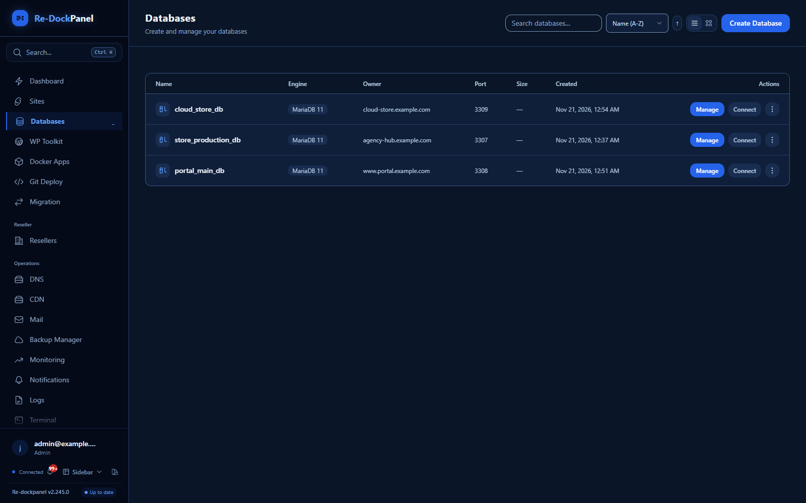
</details>

<details>
<summary><strong>Database Studio & Browser</strong> — Data browser, double-click inline cell editing, SQL console, structure, robust import/export</summary>

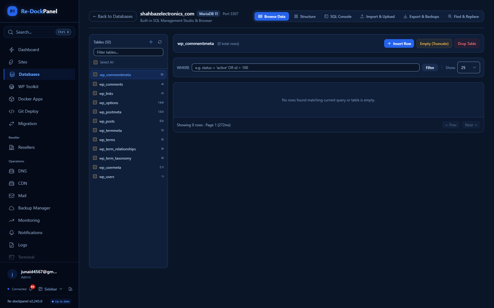
</details>

<details>
<summary><strong>File Manager</strong> — Browse, edit, upload files from the browser</summary>


</details>

<details>
<summary><strong>Terminal</strong> — Full SSH in the browser with tabs, themes, session recording</summary>


</details>

<details>
<summary><strong>Git Deploy</strong> — Push-to-deploy, atomic zero-downtime deploys, preview environments</summary>


</details>

<details>
<summary><strong>Monitoring</strong> — HTTP/TCP/ping uptime checks, SLA tracking, PagerDuty integration</summary>


</details>

<details>
<summary><strong>Security</strong> — Firewall, Fail2Ban, SSH hardening, vulnerability scanning, audit logs</summary>


</details>

<details>
<summary><strong>Backups</strong> — Scheduled backups, S3/SFTP destinations, one-click restore</summary>


</details>

<details>
<summary><strong>DNS</strong> — Cloudflare + PowerDNS, zone management, cache purge, security settings</summary>


</details>

<details>
<summary><strong>Mail</strong> — Postfix + Dovecot + DKIM, Roundcube webmail, Rspamd spam filter</summary>


</details>

<details>
<summary><strong>Cron Jobs</strong> — Scheduled tasks with output logging</summary>


</details>

<details>
<summary><strong>System</strong> — Services, updates, diagnostics, auto-healing</summary>


</details>

<details>
<summary><strong>Settings</strong> — Branding, notifications, alert channels, account security</summary>

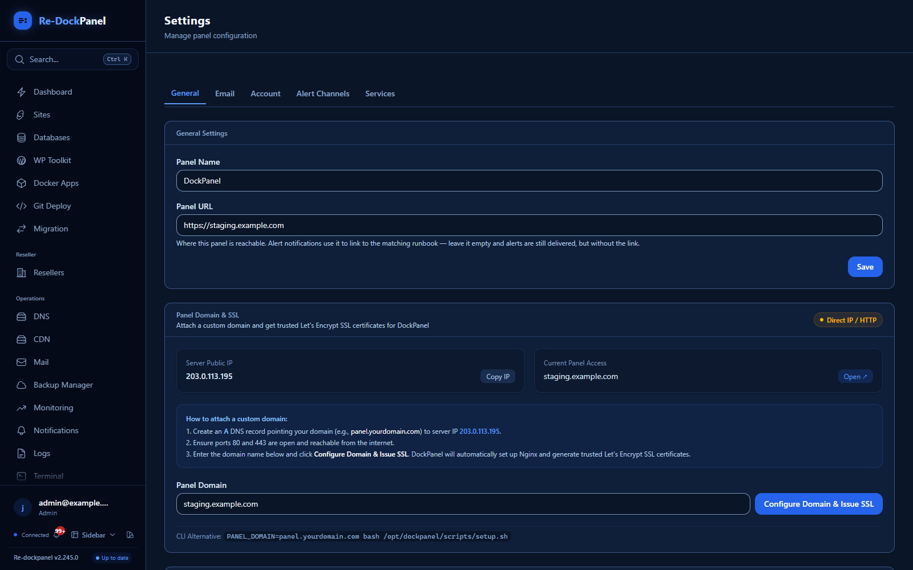
</details>

<details>
<summary><strong>Login</strong> — Email/password + passkey (WebAuthn) support</summary>


</details>

## Features

### Hosting
- **Sites** — Static, PHP (8.1–8.5), Node.js, Python, reverse proxy. Automatic Nginx config, SSL, PHP-FPM pools.
- **Databases** — MySQL/PostgreSQL in Docker. Built-in SQL browser, visual schema browser, scheduled dump/restore. Auto-cleanup on site delete.
- **Docker Apps** — 147 templates across 14 categories (AI, CMS, Database, Media, Monitoring, and more). Compose stacks. Resource limits. GPU passthrough.
- **Git Deploy** — Push-to-deploy. Atomic zero-downtime deploys (Capistrano-style). Nixpacks (30+ languages). Preview environments.
- **WordPress Toolkit** — Multi-site dashboard, vulnerability scanning, security hardening, bulk updates.
- **CMS Install** — WordPress, Laravel, Drupal, Joomla, Symfony, CodeIgniter — one click.
- **Backups** — Scheduled, S3/SFTP remote destinations, one-click restore.
- **Backup Orchestrator** — DB/volume backups, AES-256 encryption, restore verification, cross-resource policies, S3/SFTP/B2/GCS destinations, health dashboard.
- **CDN** — BunnyCDN and Cloudflare CDN management. Cache purge, bandwidth stats, pull zone discovery.
- **Image Optimization** — Server-side WebP/AVIF conversion per site.
- **Secrets Manager** — AES-256-GCM encrypted vaults, version history, auto-inject to .env, masked API, CLI pull endpoint.
- **Webhook Gateway** — Inbound endpoints with unique URLs, HMAC-SHA256/SHA1 verification, request inspector, route builder, retry/replay.

### Operations
- **Multi-Server** — Manage remote servers from one panel. Agent auto-registers.
- **DNS** — Cloudflare + PowerDNS. Zone templates, propagation checker, DNSSEC. Cloudflare cache purge, security settings, `cloudflared` install/uninstall.
- **Container Management** — Auto-sleep (stop idle containers), auto-update detection, per-user isolation policies.
- **Mail** — Postfix + Dovecot + OpenDKIM. Webmail (Roundcube), spam filter (Rspamd), SMTP relay.
- **Monitoring** — HTTP/TCP/ping uptime checks, SLA tracking, PagerDuty integration.
- **Prometheus + Grafana** — Token-gated `/api/metrics` scrape endpoint (off by default) plus a drop-in [fleet dashboard](dashboards/dockpanel-grafana.json) covering CPU/memory/disk, GPU utilization/VRAM/temp/power, sites, and alerts. See [docs/guides/prometheus.md](docs/guides/prometheus.md).
- **Incident Management** — Full lifecycle (investigating, identified, monitoring, resolved, postmortem), severity levels, timeline, affected components.
- **Public Status Page** — Standalone dark-themed page at `/status`, component groups, email subscribers, overall status auto-computed from checks.
- **Terminal** — Full SSH with tabs, themes, sharing, session recording.

### Security
- **Passkey/WebAuthn** — Passwordless login with biometrics or security keys. Plus 2FA/TOTP with recovery codes.
- **WAF** — ModSecurity3 + OWASP CRS v4 per site. Detection or prevention mode. Event viewer.
- **CSP & Bot Protection** — Per-site Content Security Policy headers and bot rate limiting.
- **Firewall** — UFW management with smart port opener.
- **Fail2Ban** — View/ban/unban IPs, panel-specific jail.
- **SSH Hardening** — Disable password/root login, change port — one click.
- **Vulnerability Scanning** — File integrity, security headers, full-server audits.
- **Per-Image CVE Scanning** — Scan every running Docker app's image with Anchore grype. Severity badge per app row on the Apps page. Scheduled background rescans (configurable interval). Soft deploy gate refuses images exceeding a critical/high/medium threshold — on template deploys, image changes, compose deploys and stacks alike. Grype installs self-contained into `/var/lib/dockpanel/scanners/` from the Settings UI. **Defaults to off** — opt in from Settings → Services → Image Vulnerability Scanning.
- **Signed Releases + SBOM** — Every release binary and its SPDX SBOM is signed in CI with cosign keyless via Sigstore (no long-lived signing key, recorded in the public Rekor transparency log). Verification snippet in [SECURITY.md](SECURITY.md#verifying-release-signatures).
- **Per-Image SBOM Generation** — Generate an SPDX 2.3 JSON SBOM for any deployed Docker app's image on demand (syft). Click "Download SBOM" in any app's scan drawer. Self-contained install at `/var/lib/dockpanel/scanners/syft`. **Defaults to off** — opt in from Settings → Services → SBOM Generation. Companion to image CVE scanning: composition vs. risk.
- **Auto-Healing** — Restart crashed services, clean disk, renew expiring SSL, auto-sleep idle containers.

### Developer Experience
- **CLI** — `dockpanel status`, `sites`, `apps`, `diagnose`, `export`, `apply`
- **MCP Server** — Read-only fleet introspection (~40 tools: sites, apps, databases, logs, security, monitors, alerts, and more) for AI agents over the Model Context Protocol. Opt-in, off by default, zero mutating tools. See [docs.dockpanel.dev](https://docs.dockpanel.dev).
- **Infrastructure as Code** — Export/import server config as YAML. A Terraform/Pulumi-shaped provider API also exists for reading site/database inventory (see [FEATURES.md](FEATURES.md#withdrawn-claims) — its tokens don't yet authenticate).
- **Smart Diagnostics** — 6 check categories with one-click fixes. Auto-optimization recommendations.
- **File Manager** — Browse, edit, upload files from the browser.
- **Command Palette** — Ctrl+K to navigate anywhere.
- **Nginx FastCGI Cache** — Per-site toggle with smart bypass for logged-in users.
- **Redis Object Cache** — Per-site isolated Redis DB with WP auto-config.

### Themes & Layouts
- **6 Themes** — Terminal (hacker green), Midnight (navy blue), Ember (warm amber), Arctic (light teal), Clean (light blue SaaS), Clean Dark (GitHub-dark).
- **3 Layouts** — Sidebar (full sidebar nav), Compact (collapsible icon rail), Topbar (horizontal navbar).

### Business
- **Reseller Accounts** — Admin → Reseller → User hierarchy with quotas.
- **White-Label** — Custom logo, colors, panel name per reseller.
- **OAuth/SSO** — Google, GitHub, GitLab login.
- **Extension API** — Webhook events with HMAC signing.
- **WHMCS Integration** — Provisioning, suspension, termination hooks. Auto-create users from billing.
- **Migration Wizard** — Import from cPanel, HestiaCP. Plesk (beta).

## Architecture

```
Browser → React 19 SPA → Nginx
                           ├── /api/* → API (Rust/Axum)
                           │              ├── PostgreSQL 16
                           │              └── Agent (Unix socket / HTTPS)
                           │                     └── Docker, Nginx, SSL, files, terminal
                           └── /*     → Frontend (static files)
```

**4 Rust binaries**: Agent (~22MB), API (~25MB), CLI (~3.9MB), MCP server (~6.1MB, opt-in). Runtime RAM: ~35MB agent + ~14MB API ≈ 49MB for the panel itself; ~109MB with the bundled PostgreSQL. 17 supervised background services.

| Component | Tech | Role |
|-----------|------|------|
| Agent | Rust/Axum | Root-level host operations (Docker, Nginx, SSL, files) |
| API | Rust/Axum + SQLx | Auth, business logic, multi-server dispatch, background tasks |
| CLI | Rust/Clap | Command-line interface for automation |
| Frontend | React 19 + Vite + Tailwind 4 | Browser UI with 6 themes + 3 layouts |

## Security

DockPanel has undergone seven rounds of security auditing (280+ vulnerabilities found and fixed). Credentials are encrypted at rest with AES-256-GCM. All child processes run with sanitized environments. Per-image CVE scanning (grype) with optional deploy gating catches vulnerable images before they ship. See [SECURITY.md](SECURITY.md) for details.

## Development

```bash
git clone https://github.com/ovexro/dockpanel.git && cd dockpanel

# Start database
docker run -d --name dockpanel-postgres \
  -e POSTGRES_USER=dockpanel -e POSTGRES_PASSWORD=dockpanel -e POSTGRES_DB=dockpanel \
  -p 5450:5432 postgres:16

# Build
cargo build --release --manifest-path panel/agent/Cargo.toml
cargo build --release --manifest-path panel/backend/Cargo.toml
cargo build --release --manifest-path panel/cli/Cargo.toml
cd panel/frontend && npm install && npx vite build
```

See [CONTRIBUTING.md](CONTRIBUTING.md) for full development setup.

## CLI

```bash
dockpanel status              # Server status (CPU, RAM, disk)
dockpanel sites               # List all sites
dockpanel apps                # List Docker apps
dockpanel diagnose            # Run smart diagnostics
dockpanel export -o config.yml  # Export server config as YAML
dockpanel apply config.yml    # Apply config (Infrastructure as Code)
```

## Update / Uninstall

```bash
sudo bash /opt/dockpanel/scripts/update.sh     # Update
sudo bash /opt/dockpanel/scripts/uninstall.sh   # Remove
```

## Documentation

- [DockPanel Desktop Guide](docs/desktop/README.md) — Local development environment with WSL2, zero-UAC domains, and live sync
- [Live Docs](https://docs.dockpanel.dev) — Getting started, guides, configuration
- [How DockPanel is tested](https://docs.dockpanel.dev/testing.html) — The fresh-VPS drills, what they found, and what is still broken
- [FEATURES.md](FEATURES.md) — Complete feature manifest (60+ features, ~280 capabilities)
- [CHANGELOG.md](CHANGELOG.md) — Version history
- [SECURITY.md](SECURITY.md) — Security model and vulnerability reporting
- [CONTRIBUTING.md](CONTRIBUTING.md) — Development setup and PR process

## License

**GNU Affero General Public License v3.0.** DockPanel is free software — run it, read it,
change it, and redistribute it, on as many servers as you like, commercially included.
There is no premium tier and nothing is held back.

The one obligation the AGPL adds over the GPL: if you modify DockPanel and offer it to
other people *as a service over a network*, you have to make your modified source
available to those users. Running an unmodified copy, or running a modified copy for
yourself or your own company, obliges you nothing. See [LICENSE](LICENSE) for the full text.

Copyright © 2026 DockPanel.

## Supporting DockPanel

DockPanel is built and maintained by one developer. It has no company behind it, no
investors to answer to, no telemetry, and nothing gated — which is why the roadmap is
decided by what actually helps people running servers rather than by what converts.

If it saved you the cost of a control-panel licence, you can put some of that back:

- **[GitHub Sponsors](https://github.com/sponsors/ovexro)** — recurring, and it shows up
  on the repo
- **[PayPal](https://www.paypal.com/paypalme/ovexro)** — one-off, no account needed

What that funds, concretely: a wider fleet of test VPSes so releases are verified on more
distributions before they ship, faster turnaround on security fixes, and time for the
bigger features on the roadmap. Every version stays free either way.
